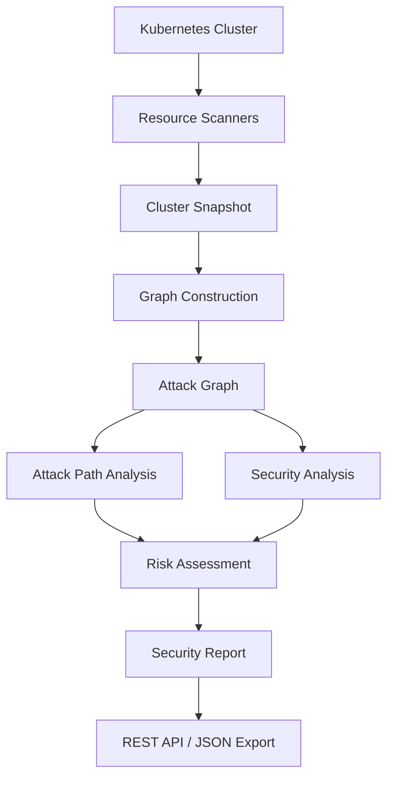

# Kubernetes Attack Path Visualizer

**Discover Kubernetes security risks through graph-based attack path analysis.**

Kubernetes Attack Path Visualizer is a tool designed to analyze Kubernetes cluster security by scanning resources, mapping their relationships into a graph, and identifying potential attack paths.

It evaluates resource configurations and permissions to detect security risks, analyzes how an attacker could potentially move through connected resources, and generates structured security reports containing findings, severity levels, risk scores, attack paths, and remediation recommendations.

## Key Features

- **Kubernetes Resource Scanning:** Scans 10 categories of Kubernetes resources using the Fabric8 Kubernetes Client to collect cluster resource information.

- **Relationship Graph Construction:** Builds a graph of Kubernetes resources and their relationships, representing how different components interact within a cluster.

- **Graph-Based Attack Path Analysis:** Identifies potential attack paths by analyzing connections between workloads, identities, permissions, and sensitive resources.

- **RBAC Security Analysis:** Analyzes Roles, ClusterRoles, RoleBindings, and ClusterRoleBindings to identify excessive permissions and potential privilege escalation risks.

- **Risk Scoring:** Calculates numerical risk scores based on secret sensitivity, permission scope, wildcard permissions, and attack path length.

- **Critical Resource Identification:** Identifies resources that represent significant security risks based on their relationships and exposure within the cluster.

- **Security Findings and Recommendations:** Generates structured security findings with severity classifications, risk scores, attack paths, and remediation recommendations.

- **JSON Security Report Export:** Provides a REST API to export security analysis results as structured JSON reports.


## How It Works

Kubernetes Attack Path Visualizer follows a multi-stage analysis pipeline to transform Kubernetes cluster resources into actionable security insights.

1. **Cluster Scanning:** Connects to a Kubernetes cluster using the Fabric8 Kubernetes Client and collects information about supported resources through dedicated scanners.

2. **Snapshot Assembly:** Combines the collected resource information into a unified cluster snapshot, providing a structured representation of the cluster.

3. **Graph Construction:** Converts the cluster snapshot into an attack graph, representing Kubernetes resources as nodes and their relationships as directed edges.

4. **Attack Path Analysis:** Applies graph algorithms to analyze resource connectivity, discover potential attack paths, evaluate reachability, and assess the impact of compromised resources.

5. **Security Analysis:** Evaluates permissions, sensitive resources, and resource relationships to identify security weaknesses and generate findings.

6. **Risk Assessment:** Calculates risk scores for identified findings and assigns severity levels based on the scoring methodology.

7. **Report Generation:** Aggregates findings, attack paths, critical resources, and remediation recommendations into a structured security report.

8. **Report Export:** Exposes the generated security report through a REST API, allowing it to be retrieved as JSON or downloaded as an attachment.


### Analysis Pipeline



## Architecture Overview

The project follows a modular architecture that separates Kubernetes resource collection, graph construction, security analysis, and report generation.

The backend is organized into the following major components:

| Component | Responsibility |
|---|---|
| **Kubernetes Scanners** | Collect information about supported Kubernetes resources using the Fabric8 Kubernetes Client. |
| **Snapshot Layer** | Represents collected cluster resources in structured snapshot objects. |
| **Graph Engine** | Constructs and manages the resource relationship graph using nodes and directed edges. |
| **Analysis Engine** | Performs graph traversal, attack-path discovery, reachability analysis, and security risk evaluation. |
| **Security Analysis** | Generates security findings, calculates risk scores, identifies critical resources, and produces recommendations. |
| **Report Export Layer** | Converts security analysis results into structured JSON responses and exposes report export endpoints through REST APIs. |

The architecture is designed to keep resource scanning, graph processing, security analysis, and report generation independent and maintainable.


## Supported Kubernetes Resources

The tool currently scans 10 categories of Kubernetes resources using dedicated scanners built with the Fabric8 Kubernetes Client.

| Category | Kubernetes Resource | Description |
|---|---|---|
| Core | Namespace | Discovers namespaces within the cluster. |
| Core | Pod | Collects workload information, including associated service accounts. |
| Core | Service | Identifies services and their relationships with workloads. |
| Identity | ServiceAccount | Collects service account identities used by workloads. |
| RBAC | Role | Retrieves namespace-scoped permission rules. |
| RBAC | ClusterRole | Retrieves cluster-level permission rules. |
| RBAC | RoleBinding | Identifies bindings between subjects and Roles or ClusterRoles. |
| RBAC | ClusterRoleBinding | Identifies cluster-wide role bindings. |
| Configuration | Secret | Collects Secret metadata and sensitivity-related information without capturing Secret values. |
| Configuration | ConfigMap | Collects ConfigMap resource information and metadata. |

Each resource category has a dedicated scanner responsible for retrieving and converting Kubernetes resources into structured snapshot representations.

These snapshots are subsequently used by the graph construction and security analysis components.

## Graph Model and Relationship Types

The tool represents Kubernetes cluster resources as a directed graph, called the **Attack Graph**.

The graph consists of two primary components:

- **Nodes:** Represent Kubernetes resources such as Pods, Services, ServiceAccounts, Roles, RoleBindings, Secrets, and other supported resource types.
- **Edges:** Represent relationships and interactions between resources. Each edge has a direction and a relationship type.

This graph-based representation allows the analysis engine to understand how resources are connected and identify potential paths through which an attacker could move within a cluster.

### Graph Structure

The graph is built using an adjacency-list representation, supporting efficient traversal and relationship analysis.

Each graph node represents a Kubernetes resource, while directed edges describe relationships between resources.

### Relationship Types

The graph engine supports the following relationship types:

| Relationship | Description |
|---|---|
| `USES` | Represents a resource using another resource. |
| `BINDS` | Represents a binding connecting a subject to a role. |
| `SELECTS` | Represents a Service selecting workloads through label selectors. |
| `ROUTES_TO` | Represents traffic routing towards another resource. |
| `MOUNTS` | Represents a workload mounting a resource. |
| `EXPOSES` | Represents a resource exposing another resource. |
| `CAN_ACCESS` | Represents an access relationship between resources. |
| `CAN_IMPERSONATE` | Represents the ability to impersonate another identity. |
| `DEPENDS_ON` | Represents a dependency between resources. |
| `OWNS` | Represents an ownership relationship. |
| `HAS_BINDING` | Represents a resource having an associated binding. |
| `GRANTS` | Represents a role or permission granting access to another resource. |

### Attack Path Representation

Attack paths are represented as sequences of connected graph nodes and edges.

For example, a potential attack path could be:

`Pod → ServiceAccount → ClusterRoleBinding → Secret`

Such a path illustrates how a compromised workload identity may be connected to sensitive resources through Kubernetes RBAC relationships.

The graph provides the foundation for attack-path discovery, reachability analysis, risk assessment, and critical resource identification.


## Security Analysis and Attack-Path Detection

The tool uses graph-based analysis to identify potential attack paths and evaluate security risks within a Kubernetes cluster.

Rather than examining resources in isolation, the analysis engine evaluates how workloads, identities, permissions, and sensitive resources are connected through the attack graph.

### Graph Analysis Algorithms

The graph engine implements several algorithms to analyze resource connectivity and potential attack paths.

| Algorithm | Purpose |
|---|---|
| Breadth-First Search (BFS) | Traverses the graph level by level to explore reachable resources. |
| Depth-First Search (DFS) | Explores graph paths by following connections as deeply as possible. |
| Dijkstra's Algorithm | Calculates shortest weighted paths through the graph. |
| Cycle Detection | Identifies cycles in resource relationships. |
| Blast Radius Analysis | Evaluates the resources reachable from a given starting point. |
| Attack Path Finder | Identifies and reconstructs potential paths between workloads and sensitive resources. |

### Attack Path Discovery

The attack path analyzer examines relationships between Kubernetes resources to identify potential routes from workloads to sensitive resources.

For example, a compromised Pod may be associated with a ServiceAccount that is connected to permissions through a RoleBinding or ClusterRoleBinding. Those permissions may provide access to sensitive resources such as Secrets.

An illustrative attack path:

`Pod → ServiceAccount → ClusterRoleBinding → Secret`

The analyzer evaluates these connections and uses the resulting paths as part of the security risk assessment.

### Security Analysis Components

The security analysis engine includes the following components:

- **Attack Path Analyzer:** Evaluates potential attack paths through the resource graph.
- **Critical Resource Analyzer:** Identifies resources with significant security exposure.
- **Risk Scorer:** Calculates numerical risk scores using multiple security factors.
- **Recommendation Engine:** Generates remediation recommendations based on identified findings.

The results are aggregated into a structured security report containing findings, severity classifications, risk scores, attack paths, and critical resource information.


## Risk Scoring Methodology

The tool assigns a numerical risk score to security findings based on multiple factors that influence the potential impact and exploitability of a security issue.

The scoring mechanism considers four primary factors:

### Risk Factors

| Factor | Description |
|---|---|
| **Secret Sensitivity** | Evaluates the sensitivity of exposed Secrets based on their type, metadata, labels, and naming patterns. |
| **Permission Scope** | Evaluates the scope of permissions associated with the resource, including namespace-level and cluster-level access. |
| **Wildcard Permissions** | Adds risk for permissions involving wildcard resources or operations, which may grant broader access than intended. |
| **Attack Path Length** | Considers the length of the identified attack path when evaluating the associated security risk. |

### Risk Score Calculation

The final risk score is calculated by combining the contributions of the four scoring factors.

Conceptually:

`Risk Score = Secret Sensitivity + Permission Scope + Wildcard Permissions + Attack Path Length`

The resulting score is capped at 100.

### Severity Classification

Each finding is assigned a severity level according to its calculated risk score.

| Severity | Risk Score |
|---|---:|
| LOW | 0–34 |
| MEDIUM | 35–54 |
| HIGH | 55–74 |
| CRITICAL | 75–100 |

### Example

Consider a finding involving a workload with a path to a sensitive Kubernetes Secret.

An illustrative score breakdown:

| Risk Factor | Score |
|---|---:|
| Secret Sensitivity | 30 |
| Permission Scope | 10 |
| Wildcard Permissions | 0 |
| Attack Path Length | 3 |
| **Total Risk Score** | **43** |

The resulting severity classification is **MEDIUM**.

This scoring approach provides a consistent way to prioritize findings based on the security risks identified during graph analysis.


## Technology Stack

The project is built using Java and the Spring Boot ecosystem, with dedicated libraries for Kubernetes communication, graph processing, and testing.

| Technology | Purpose |
|---|---|
| **Java 21** | Primary programming language. |
| **Spring Boot** | Backend application framework and REST API development. |
| **Maven** | Dependency management and build automation. |
| **Fabric8 Kubernetes Client** | Communication with Kubernetes clusters and resource discovery. |
| **Jackson** | JSON serialization and deserialization. |
| **JUnit 5** | Unit and integration testing. |
| **Mockito** | Mocking dependencies during testing. |
| **MockMvc** | Testing REST API endpoints. |
| **Minikube** | Local Kubernetes environment for live scanner integration testing. |

### Development Tools

- Git and GitHub for version control.
- IntelliJ IDEA for Java development.
- Postman and cURL for API testing.
- Linux for development and execution.


## Project Structure

The repository is organized into a Spring Boot backend and supporting sample data.

```text
attack-path-visualizer/
│
├── backend/
│   ├── src/
│   │   ├── main/
│   │   │   └── java/
│   │   └── test/
│   │       └── java/
│   │
│   ├── pom.xml
│   ├── mvnw
│   └── mvnw.cmd
│
├── sample-data/
│   ├── clusters/
│   │   ├── isolated-resources.json
│   │   ├── multi-path-cluster.json
│   │   ├── simple-cluster.json
│   │   └── vulnerable-cluster.json
│   │
│   └── reports/
│       └── security-report-vulnerable-cluster.json
│
├── .gitignore
└── README.md
```


## Prerequisites

Before setting up the project, ensure the following tools are installed:

| Requirement | Version / Details |
|---|---|
| Java Development Kit (JDK) | 21 |
| Git | For cloning the repository |
| Kubernetes Cluster | Minikube or another accessible Kubernetes cluster |
| kubectl | Kubernetes command-line tool |
| Maven | Optional, as the project includes Maven Wrapper |

A running Kubernetes cluster is required for live cluster scanning. Snapshot-based analysis and the standard test suite can be performed without connecting to a live cluster.


## Installation and Setup

Follow these steps to set up the project locally.

### 1. Clone the Repository

```bash
git clone https://github.com/kunal2006999/attack-path-visualizer.git
cd attack-path-visualizer
```

### 2. Navigate to the Backend

```bash
cd backend
```

### 3. Verify Java Installation

Ensure that JDK 21 is installed:

```bash
java -version
```

### 4. Build the Project

Use the included Maven Wrapper to compile the application:

**Linux / macOS:**

```bash
chmod +x mvnw
./mvnw clean compile
```

**Windows:**

```powershell
mvnw.cmd clean compile
```

### 5. Configure Kubernetes Access

For live cluster scanning, ensure that:

- A Kubernetes cluster is running and accessible.
- `kubectl` is installed and configured.
- Your current Kubernetes context points to the intended cluster.
- Your credentials have sufficient permissions to read the Kubernetes resources being scanned.

Verify your active Kubernetes context:

```bash
kubectl config current-context
```

The application uses the Kubernetes client configuration to connect to the cluster.

**Note:** A live Kubernetes cluster is required for actual cluster scanning. Snapshot-based analysis and the standard test suite can run without connecting to a live cluster.

**Note:** The Maven Wrapper downloads and uses the configured Maven version, so a separate Maven installation is not required.

## Running the Application

After completing the installation and setup, follow these steps to run the backend application.

### 1. Navigate to the Backend Directory

```bash
cd backend
```

### 2. Start the Spring Boot Application

Run the application using the Maven Wrapper.

**Linux / macOS:**

```bash
./mvnw spring-boot:run
```

**Windows:**

```powershell
mvnw.cmd spring-boot:run
```

### 3. Verify Application Startup

Wait for Spring Boot to complete its startup process.

By default, the application runs at:

`http://localhost:8080`

The port may differ if overridden in the application configuration.

### 4. Verify Kubernetes Connectivity

For live cluster scanning, ensure that your Kubernetes cluster is running and accessible.

Check the active Kubernetes context:

```bash
kubectl config current-context
```

Check cluster connectivity:

```bash
kubectl cluster-info
```

The application uses the configured Kubernetes client credentials to communicate with the cluster.

### Important Notes

- A running Kubernetes cluster is required for live resource scanning.
- The configured Kubernetes identity must have sufficient permissions to access the resources being scanned.
- Starting the Spring Boot application does not automatically initiate a cluster scan.
- Snapshot-based analysis does not require a live Kubernetes cluster.


## Running Tests

The project includes unit tests, integration tests, and end-to-end tests to validate resource scanning, graph construction, security analysis, and report generation.

All test commands should be executed from the `backend/` directory.

### 1. Run the Standard Test Suite

Execute the following command:

```bash
./mvnw clean test
```

This runs the standard test suite without requiring a live Kubernetes cluster.

### 2. Run Live Kubernetes Integration Tests

The project includes integration tests that interact with an actual Kubernetes cluster to validate resource scanners and the complete security analysis pipeline.

These tests use Minikube as the local Kubernetes environment.

Start Minikube:

```bash
minikube start
```

Verify the active Kubernetes context:

```bash
kubectl config current-context
```

Run the live scanner and security pipeline integration tests:

```bash
./mvnw -Pintegration -Dtest='LiveScannerIntegrationTest,LiveSecurityPipelineIntegrationTest' test
```

### 3. Run All Integration Tests

To execute all integration-tagged tests, including the existing integration tests, run:

```bash
./mvnw -Pintegration verify
```

### Test Coverage

The test suite validates the following areas:

- Kubernetes resource scanning and snapshot assembly.
- Graph node and edge construction.
- Graph traversal and attack-path analysis.
- RBAC relationship handling.
- Security findings and risk scoring.
- Critical resource identification.
- Security report generation and JSON export.
- REST API responses and download headers.
- Live Kubernetes resource discovery and scanner behavior.
- Error handling for inaccessible clusters and insufficient permissions.

### Important Notes

- Standard tests do not require Minikube or a live Kubernetes cluster.
- Live integration tests require a running Minikube cluster.
- The Kubernetes identity used for integration tests must have sufficient permissions to create, inspect, and delete the test resources.
- Integration tests create controlled Kubernetes resources and clean them up after execution.
- The live integration tests include safeguards to prevent accidental execution against an unintended cluster.

## API Documentation

The application exposes a REST API to perform security analysis on a Kubernetes cluster snapshot and export the resulting security report in JSON format.

### Security Report Export

| Property | Value |
|---|---|
| **Endpoint** | `/api/security/reports/export` |
| **HTTP Method** | `POST` |
| **Content-Type** | `application/json` |
| **Response Format** | JSON |

The endpoint accepts a Kubernetes cluster snapshot, executes the graph construction and security analysis pipeline, and returns the generated security report.

### Request Parameters

The endpoint supports the following query parameter:

| Parameter | Type | Default | Description |
|---|---|---|---|
| `download` | Boolean | `false` | When set to `true`, returns the JSON report as a downloadable attachment. |

### Request Body

The request body must contain a valid Kubernetes cluster snapshot in JSON format.

The snapshot is validated and processed through the following stages:

1. Cluster snapshot validation.
2. Graph construction.
3. Attack-path and security analysis.
4. Risk assessment.
5. Security report generation.

The expected request structure follows the `ClusterSnapshot` model.

### Example Request

```bash
curl -X POST http://localhost:8080/api/security/reports/export \
  -H "Content-Type: application/json" \
  -d @../sample-data/clusters/vulnerable-cluster.json
```

### Download Security Report

To download the generated report as a JSON attachment:

```bash
curl -X POST \
  "http://localhost:8080/api/security/reports/export?download=true" \
  -H "Content-Type: application/json" \
  -d @../sample-data/clusters/vulnerable-cluster.json \
  -o security-report.json
```

The downloaded filename is generated using the cluster name:

`security-report-<cluster-name>.json`

### Response Structure

The API returns a structured JSON security report containing the following top-level fields:

| Field | Description |
|---|---|
| `clusterName` | Name of the analyzed Kubernetes cluster. |
| `generatedAt` | Timestamp indicating when the report was generated. |
| `totalFindings` | Total number of security findings. |
| `severityCounts` | Number of findings grouped by severity. |
| `findings` | Detailed list of identified security findings. |
| `criticalResources` | List of resources identified as critical during analysis. |

Each finding contains:

- Finding ID, title, and description.
- Entry-point and target resource information.
- Identified attack path.
- Numerical risk score and severity.
- Individual risk score factors and their explanations.
- Remediation recommendation.

Each critical resource contains:

- Resource information.
- Risk score.
- Number of affected Secrets.
- Number of associated findings.
- Explanation of why the resource is considered critical.

### Example Security Report

The repository includes a complete security report generated from `vulnerable-cluster`. It demonstrates the exported report structure, including finding details, structured attack-path nodes, risk factors, severity classifications, critical resources, and remediation recommendations.

You can view the complete JSON report here:

[`security-report-vulnerable-cluster.json`](sample-data/reports/security-report-vulnerable-cluster.json)


## Sample Cluster Data

The repository includes sample Kubernetes cluster snapshots that can be used to test and demonstrate the security analysis pipeline without requiring a live Kubernetes cluster.

### Available Samples

| File | Description |
|---|---|
| `simple-cluster.json` | Represents a basic Kubernetes cluster configuration. |
| `vulnerable-cluster.json` | Contains deliberately modeled security weaknesses and attack paths for demonstrating security analysis. |
| `multi-path-cluster.json` | Demonstrates multiple potential attack paths within a cluster. |
| `isolated-resources.json` | Contains resources with limited or no relevant graph connections. |

### Generated Security Report

The generated report is linked in the [API Documentation](#api-documentation).

It demonstrates the tool's ability to identify multiple paths from a workload to a sensitive Secret, calculate risk scores, classify findings by severity, and identify critical resources.

The sample data is intended for testing and demonstration purposes and does not represent a production Kubernetes environment.


## Security Considerations

- **Secret Data Protection:** The scanner collects Kubernetes Secret metadata for security analysis without capturing or exporting actual Secret values.
- **RBAC Permissions:** The Kubernetes identity used by the application should have only the permissions required for scanning supported resources.
- **Cluster Access:** Always verify the active Kubernetes context before running live scans to avoid unintentionally scanning the wrong cluster.
- **Test Environment:** Use a dedicated test cluster such as Minikube when running live integration tests.
- **Security Findings:** Reported attack paths represent modeled access relationships derived from collected resources and RBAC rules. They should be validated against the actual cluster configuration.


## Limitations

- **Resource Coverage:** Currently supports 10 categories of Kubernetes resources. Other resource types are not yet included in the scanning pipeline.
- **Analysis Scope:** Security findings depend on the resources and relationships collected during scanning. Unmodeled relationships may result in incomplete attack paths.
- **Risk Scoring:** Risk scores are heuristic estimates based on predefined factors and weights, not guarantees of real-world exploitability.
- **Cluster Access:** Live scanning depends on Kubernetes API availability and sufficient permissions.
- **Frontend:** The project currently provides a backend REST API without a dedicated graphical user interface.
- **Persistence:** Security reports are generated on demand and are not stored in a persistent database.


## Future Improvements

Potential areas for extending the project include:

- **Expanded Resource Coverage:** Add scanners for Deployments, Ingresses, PersistentVolumes, PersistentVolumeClaims, and additional Kubernetes resources.
- **Advanced Security Analysis:** Extend attack-path detection to cover more complex privilege escalation scenarios and Kubernetes security misconfigurations.
- **Visualization:** Develop a graphical interface for interactive attack graph exploration and security report visualization.
- **Historical Analysis:** Introduce persistent storage to track security findings and compare reports across multiple scans.
- **Automated Scanning:** Support scheduled cluster scans and continuous security monitoring.
- **Report Enhancements:** Add additional export formats and more detailed security recommendations.
