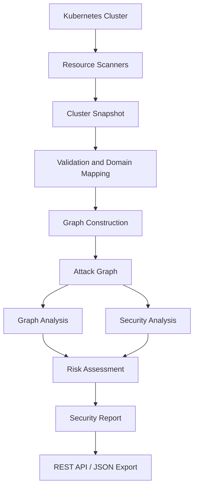

# Kubernetes Attack Path Visualizer

**Discover potential Kubernetes security risks through graph-based attack-path analysis.**

Kubernetes Attack Path Visualizer is a Java/Spring Boot backend that collects Kubernetes resource information, models relationships between resources as a directed graph, and analyzes that graph to identify potential paths from workloads and identities to sensitive resources.

It produces structured security reports containing findings, severity classifications, heuristic risk scores, attack paths, critical resources, and remediation recommendations.

> **Project status:** Core backend implementation is complete. The project supports snapshot-based analysis and live Kubernetes scanning. It currently provides REST APIs; a graphical frontend and persistent report storage are not included.

---

## Contents

- [Key Features](#key-features)
- [How It Works](#how-it-works)
- [Architecture](#architecture)
- [Supported Kubernetes Resources](#supported-kubernetes-resources)
- [Graph Model](#graph-model)
- [Security Analysis](#security-analysis)
- [Risk Scoring](#risk-scoring)
- [Technology Stack](#technology-stack)
- [Repository Structure](#repository-structure)
- [Prerequisites](#prerequisites)
- [Installation and Setup](#installation-and-setup)
- [Running the Application](#running-the-application)
- [API Documentation](#api-documentation)
- [Sample Data](#sample-data)
- [Testing](#testing)
- [Security Considerations](#security-considerations)
- [Limitations](#limitations)
- [Future Improvements](#future-improvements)

---

## Key Features

- **Live Kubernetes scanning:** Connects to the Kubernetes cluster configured in the current kubeconfig context using the Fabric8 Kubernetes Client.
- **Snapshot-based analysis:** Accepts a JSON cluster snapshot and analyzes it without requiring a live cluster.
- **Resource relationship modeling:** Converts collected resources and their relationships into a directed attack graph.
- **Graph algorithms:** Includes BFS, DFS, Dijkstra's shortest-path analysis, cycle detection, reachability analysis, blast-radius analysis, and attack-path reconstruction.
- **RBAC relationship analysis:** Models Roles, ClusterRoles, RoleBindings, ClusterRoleBindings, and their relationships with subjects and workloads.
- **Potential attack-path detection:** Identifies modeled paths connecting workloads and identities to sensitive resources such as Kubernetes Secrets.
- **Risk scoring:** Calculates heuristic scores using secret sensitivity, permission scope, wildcard permissions, and attack-path length.
- **Critical resource identification:** Highlights resources that participate in findings or are connected to sensitive resources.
- **Remediation recommendations:** Produces recommendations alongside security findings.
- **JSON report export:** Returns reports through REST endpoints and supports downloadable JSON attachments.

## How It Works

The analysis pipeline transforms Kubernetes resource information into a structured security report:

1. **Resource collection:** Dedicated scanners retrieve supported Kubernetes resources.
2. **Snapshot assembly:** The collected resources are combined into a `ClusterSnapshot`.
3. **Validation and mapping:** The snapshot is validated and mapped into the project's domain model.
4. **Graph construction:** Resources become graph nodes and their modeled relationships become directed edges.
5. **Graph analysis:** Graph algorithms analyze reachability, paths, cycles, and potential blast radius.
6. **Security analysis:** The security engine evaluates modeled access relationships and identifies potential findings.
7. **Risk assessment:** Findings receive heuristic risk scores and severity classifications.
8. **Report generation:** Findings, attack paths, critical resources, and recommendations are assembled into a JSON report.

### Analysis pipeline



Snapshot-based analysis enters the pipeline at the `Cluster Snapshot` stage and does not require a live Kubernetes connection.

---

## Architecture

The backend separates resource collection, graph construction, analysis, and report generation into dedicated packages.

| Component | Responsibility |
|---|---|
| `scanner` | Reads supported resources from Kubernetes and assembles cluster snapshots. |
| `common.model.snapshot` | Defines snapshot representations used by parsing and scanning. |
| `common.util` | Parses cluster snapshot JSON. |
| `common.exception` | Defines application exceptions and centralized REST error handling. |
| `core.model` | Represents Kubernetes resources in the domain model. |
| `core.builder` | Maps snapshots and builds resource relationships. |
| `core.pipeline` | Coordinates validation, mapping, and graph construction. |
| `graph` | Provides graph nodes, edges, construction, and export functionality. |
| `analysis` | Implements graph traversal and path-analysis algorithms. |
| `security` | Performs attack-path security analysis, risk scoring, critical-resource analysis, and recommendation generation. |
| `report` | Exposes report APIs and serializes reports to JSON. |

### Supported Kubernetes resources

The live scanner currently collects these 10 resource categories:

| Category | Kubernetes resource | Purpose |
|---|---|---|
| Core | Namespace | Discovers namespaces. |
| Core | Pod | Collects Pod information, including its associated ServiceAccount. |
| Core | Service | Collects Service information and modeled workload relationships. |
| Identity | ServiceAccount | Collects workload identities. |
| RBAC | Role | Collects namespace-scoped permission rules. |
| RBAC | ClusterRole | Collects cluster-level permission rules. |
| RBAC | RoleBinding | Collects bindings between subjects and Roles or ClusterRoles. |
| RBAC | ClusterRoleBinding | Collects cluster-wide role bindings. |
| Configuration | Secret | Collects Secret metadata for analysis. |
| Configuration | ConfigMap | Collects ConfigMap information and metadata. |

The repository's snapshot/domain models may represent additional Kubernetes resource types. The table above describes the resource categories currently collected by the live scanner.

---

## Graph Model

The project represents modeled Kubernetes resources as a directed graph called the **Attack Graph**.

- **Nodes** represent resources such as Pods, Services, ServiceAccounts, Roles, RoleBindings, and Secrets.
- **Edges** represent modeled relationships between resources. Edges have a direction and a relationship type.
- **Adjacency-list representation** supports graph traversal and relationship analysis.

### Relationship types

The graph engine defines relationship types including:

| Relationship | Description |
|---|---|
| `USES` | A resource uses another resource. |
| `BINDS` | A binding connects a subject to a role. |
| `SELECTS` | A Service selects workloads through label selectors. |
| `ROUTES_TO` | Traffic is modeled as routing towards another resource. |
| `MOUNTS` | A workload mounts a resource. |
| `EXPOSES` | A resource exposes another resource. |
| `CAN_ACCESS` | A modeled access relationship between resources. |
| `CAN_IMPERSONATE` | A modeled ability to impersonate another identity. |
| `DEPENDS_ON` | A dependency between resources. |
| `OWNS` | An ownership relationship. |
| `HAS_BINDING` | A resource has an associated binding. |
| `GRANTS` | A role or permission grants modeled access. |

Not every relationship type is necessarily produced by every scan. The graph contains relationships that can be derived from the collected resource data and implemented modeling rules.

### Example attack path

```text
Pod
 |
 v
ServiceAccount
 |
 v
ClusterRoleBinding
 |
 v
Secret
```

This example represents a modeled path in which a workload's ServiceAccount is bound to permissions that may allow access to a Secret.

---

## Security Analysis

The security analysis engine evaluates relationships across the graph rather than treating each resource in isolation.

### Graph algorithms

| Algorithm | Purpose |
|---|---|
| Breadth-First Search (BFS) | Traverses the graph level by level. |
| Depth-First Search (DFS) | Explores connected paths deeply before backtracking. |
| Dijkstra's algorithm | Finds shortest weighted paths. |
| Cycle detection | Identifies cycles in resource relationships. |
| Reachability analysis | Determines which resources can be reached from a starting node. |
| Blast-radius analysis | Evaluates the set of resources reachable from a starting point. |
| Attack-path finder | Finds and reconstructs potential paths between selected resource types. |

### Security analysis components

- **Attack Path Analyzer:** Evaluates potential paths through the resource graph.
- **Critical Resource Analyzer:** Identifies resources that appear in findings or have modeled connections to sensitive resources.
- **Risk Scorer:** Calculates a numerical risk score from configured scoring factors.
- **Secret Sensitivity Classifier:** Estimates Secret sensitivity using available metadata and naming information.
- **Recommendation Engine:** Generates remediation guidance for identified findings.

### Interpreting findings

A finding such as `Pod can reach Secret` means the collected resource data and graph rules produced a directed path representing potential access. It does **not** prove that an attacker has exploited the path or that a running process has successfully retrieved the Secret.

Findings should be reviewed against the actual cluster configuration, Kubernetes authorization behavior, and the application's threat model.

---

## Risk Scoring

The risk scorer combines four configured factors:

| Factor | Description |
|---|---|
| **Secret sensitivity** | Estimates sensitivity using Secret type, name, labels, and namespace metadata. |
| **Permission scope** | Considers the scope of the permission relationship, including whether it originates from a ClusterRoleBinding. |
| **Wildcard permissions** | Adds risk when RBAC rules contain wildcard API groups, resources, or verbs. |
| **Attack-path length** | Considers the number of edges in the modeled path. |

Conceptually:

```text
Risk Score =
    Secret Sensitivity
  + Permission Scope
  + Wildcard Permissions
  + Attack Path Length
```

The final score is capped at 100.

### Severity classification

| Severity | Risk score |
|---|---:|
| LOW | 0–34 |
| MEDIUM | 35–54 |
| HIGH | 55–74 |
| CRITICAL | 75–100 |

Risk scores are heuristic prioritization values. They are not probabilities of compromise or guarantees of exploitability.

---

## Technology Stack

| Technology | Purpose |
|---|---|
| Java 21 | Primary programming language. |
| Spring Boot | Backend application and REST APIs. |
| Maven | Build and dependency management. |
| Fabric8 Kubernetes Client | Kubernetes API communication and resource scanning. |
| Jackson | JSON parsing and serialization. |
| JUnit 5 | Automated testing. |
| Mockito | Dependency mocking in tests. |
| MockMvc | REST controller testing. |
| Minikube | Local Kubernetes environment for live testing. |

Development and API tools include Git, GitHub, IntelliJ IDEA, Linux, Postman, and cURL.

---

## Repository Structure

```text
AttackPathVisualizer/
├── backend/
│   ├── src/
│   │   ├── main/java/com/kunal/attackpathvisualizer/
│   │   │   ├── analysis/
│   │   │   ├── common/
│   │   │   ├── core/
│   │   │   ├── graph/
│   │   │   ├── report/
│   │   │   ├── scanner/
│   │   │   └── security/
│   │   └── test/java/
│   ├── pom.xml
│   ├── mvnw
│   └── mvnw.cmd
├── sample-data/
│   ├── clusters/
│   │   ├── isolated-resources.json
│   │   ├── multi-path-cluster.json
│   │   ├── simple-cluster.json
│   │   └── vulnerable-cluster.json
│   └── reports/
│       └── security-report-vulnerable-cluster.json
├── test-environment/
│   └── vulnerable-cluster.yaml
├── .gitignore
└── README.md
```

---

## Prerequisites

| Requirement | Version / details |
|---|---|
| JDK | Java 21 |
| Git | To clone the repository |
| Kubernetes cluster | Required for live scanning; Minikube is suitable for local testing |
| `kubectl` | Required to inspect and manage the test cluster |
| Maven | Optional; the repository includes Maven Wrapper |

Snapshot-based analysis and the standard test suite do not require a live Kubernetes cluster.

## Installation and Setup

### 1. Clone the repository

```bash
git clone https://github.com/kunal2006999/attack-path-visualizer.git
cd attack-path-visualizer
```

Use the actual directory name created by Git if it differs from `AttackPathVisualizer`.

### 2. Verify Java

```bash
java -version
```

Ensure Java 21 is active.

### 3. Build and test

```bash
cd backend
chmod +x mvnw
./mvnw clean test
```

The Maven Wrapper is included, so a separate Maven installation is not required.

### 4. Configure Kubernetes access for live scanning

For live scanning:

1. Ensure the intended Kubernetes cluster is running.
2. Ensure `kubectl` is installed.
3. Configure kubeconfig credentials for the cluster.
4. Check the active context:

```bash
kubectl config current-context
kubectl cluster-info
```

The live scanning service uses the Kubernetes client configuration available to the application process. The identity must be allowed to read the resource types being scanned.

---

## Running the Application

From the repository root:

```bash
cd backend
./mvnw spring-boot:run
```

The application runs at:

```text
http://localhost:8080
```

Starting the application does not automatically scan a cluster. Use one of the API endpoints below to initiate analysis.

---

## API Documentation

The application exposes two report-generation endpoints.

### 1. Analyze a supplied cluster snapshot

| Property | Value |
|---|---|
| Method | `POST` |
| Endpoint | `/api/security/reports/export` |
| Content-Type | `application/json` |
| Response | JSON security report |

This endpoint accepts a `ClusterSnapshot` JSON request body. It validates the snapshot, constructs the graph, runs security analysis, and returns the report.

#### Example request

Run from the `backend/` directory while the application is running:

```bash
curl -X POST \
  "http://localhost:8080/api/security/reports/export" \
  -H "Content-Type: application/json" \
  -d @../sample-data/clusters/vulnerable-cluster.json
```

#### Download the report

Add `download=true` to return the report as an attachment:

```bash
curl -X POST \
  "http://localhost:8080/api/security/reports/export?download=true" \
  -H "Content-Type: application/json" \
  -d @../sample-data/clusters/vulnerable-cluster.json \
  -o security-report.json
```

The filename follows this pattern:

```text
security-report-<cluster-name>.json
```

### 2. Scan the currently configured Kubernetes cluster

| Property | Value |
|---|---|
| Method | `POST` |
| Endpoint | `/api/security/reports/scan` |
| Request body | Not required |
| Response | JSON security report |

This endpoint creates a Kubernetes client using the application's current Kubernetes client configuration, scans the supported resource categories, and runs the same graph and security analysis pipeline.

#### Query parameters

| Parameter | Type | Required | Default | Description |
|---|---|---:|---|---|
| `clusterName` | String | Yes | — | Display name included in the generated report. It does not select the Kubernetes context. |
| `download` | Boolean | No | `false` | When `true`, returns the report as a downloadable JSON attachment. |

**Important:** The endpoint scans the cluster selected by the active kubeconfig context. The `clusterName` parameter is a report label only.

#### Example live scan

First, verify the context:

```bash
kubectl config current-context
```

Then call the API:

```bash
curl -X POST \
  "http://localhost:8080/api/security/reports/scan?clusterName=minikube" \
  -H "Content-Type: application/json"
```

#### Download a live scan report

```bash
curl -X POST \
  "http://localhost:8080/api/security/reports/scan?clusterName=minikube&download=true" \
  -H "Content-Type: application/json" \
  -o security-report-minikube.json
```

### Report response structure

The JSON report contains these top-level fields:

| Field | Description |
|---|---|
| `clusterName` | Report name supplied for the analyzed cluster. |
| `generatedAt` | Report generation timestamp. |
| `totalFindings` | Total number of security findings. |
| `severityCounts` | Finding counts grouped by severity. |
| `findings` | Detailed security findings. |
| `criticalResources` | Resources identified as critical by the analysis. |

A finding includes its ID, title, description, entry point, target, attack path, risk score, severity, score factors, and recommendation.

A critical-resource entry includes resource information, risk score, affected Secret count, finding count, and an explanatory reason.

### Error responses

The API uses structured JSON error responses for supported request and scan failures. Examples include:

- `400 Bad Request` for invalid snapshot input or a blank cluster name.
- `415 Unsupported Media Type` when the request content type is unsupported.
- `502 Bad Gateway` when the live Kubernetes scan fails.

---

## Sample Data

The repository includes cluster snapshots for exercising the snapshot-based analysis pipeline without connecting to a live Kubernetes cluster.

| File | Description |
|---|---|
| `simple-cluster.json` | A basic cluster configuration. |
| `vulnerable-cluster.json` | A modeled cluster containing security weaknesses and potential attack paths. |
| `multi-path-cluster.json` | A cluster demonstrating multiple potential attack paths. |
| `isolated-resources.json` | Resources with limited or no relevant graph connections. |

A sample generated report is available at:

[`sample-data/reports/security-report-vulnerable-cluster.json`](sample-data/reports/security-report-vulnerable-cluster.json)

The deliberately vulnerable Minikube manifest used for live validation is available at:

[`test-environment/vulnerable-cluster.yaml`](test-environment/vulnerable-cluster.yaml)

### Optional: Reproduce the live validation environment

**Use only a disposable local/test cluster. Do not apply this intentionally overprivileged configuration to a production cluster.**

From the repository root:

```bash
kubectl apply -f test-environment/vulnerable-cluster.yaml
```

After the resources are created, run the live scan:

```bash
curl -X POST \
  "http://localhost:8080/api/security/reports/scan?clusterName=minikube" \
  -H "Content-Type: application/json" \
  -o vulnerable-report.json
```

The validation setup is designed to model an overprivileged ServiceAccount associated with a Pod and a dummy Secret. The resulting report can be inspected for a modeled Pod-to-Secret path.

When finished, remove the test resources:

```bash
kubectl delete -f test-environment/vulnerable-cluster.yaml
```

This cleanup command deletes the resources defined in that manifest, including its test namespace and cluster-scoped RBAC resources.

---

## Testing

Run commands from the `backend/` directory.

### Standard test suite

```bash
./mvnw clean test
```

The standard suite covers snapshot parsing and validation, graph construction, graph algorithms, security analysis, report generation, and REST API behavior. It does not require a live Kubernetes cluster.

### Live Kubernetes integration tests

Live integration tests require a running Minikube cluster and a Kubernetes identity with the permissions needed by the tests.

```bash
minikube start
kubectl config current-context
```

Run the live scanner and security pipeline tests:

```bash
./mvnw -Pintegration -Dtest='LiveScannerIntegrationTest,LiveSecurityPipelineIntegrationTest' test
```

Run the integration profile's verification lifecycle:

```bash
./mvnw -Pintegration verify
```

**Caution:** Integration tests may create, inspect, and delete Kubernetes test resources. Use a disposable test cluster and verify the active context before running them.

---

## Security Considerations

- **Protect the live scan endpoint:** The endpoint uses the Kubernetes credentials available to the application. Do not expose it to untrusted users or networks without authentication, authorization, and appropriate deployment controls.
- **Use least-privilege credentials:** Grant the scanning identity only the read permissions required for the supported resource categories.
- **Check the active context:** The live endpoint uses the current kubeconfig context; `clusterName` does not switch contexts.
- **Protect Secret data:** The scanner is designed to collect Secret metadata for analysis, not actual Secret values.
- **Treat findings as modeled risks:** A graph path represents an access relationship inferred from collected data and implemented rules. It is not proof of exploitation or successful runtime access.
- **Use isolated test clusters:** The included vulnerable manifest intentionally grants excessive permissions and must only be applied to a disposable test environment.

---

## Limitations

- **Resource coverage:** Live scanning currently covers the 10 resource categories listed above. Other resource types and relationships may not be collected by the live scanner.
- **Modeled relationships:** Analysis is limited to relationships that can be derived from collected resources and implemented graph rules.
- **Authorization semantics:** Modeled RBAC access paths are not a complete substitute for Kubernetes authorization evaluation in every possible configuration.
- **Heuristic risk scoring:** Scores are based on configured factors and weights; they are prioritization estimates, not exploitability probabilities.
- **Live access requirements:** Scanning depends on Kubernetes API availability and sufficient read permissions.
- **No graphical interface:** The project currently exposes backend REST APIs and does not include a frontend.
- **No persistent report storage:** Reports are generated on demand and are not stored in a database.

## Future Improvements

Potential directions for further development include:

- Expanding live scanning to additional Kubernetes resource types and relationships.
- Improving RBAC authorization modeling and privilege-escalation analysis.
- Adding an interactive attack-graph visualization frontend.
- Persisting reports and supporting historical comparisons.
- Adding scheduled scans and continuous monitoring.
- Extending report formats and remediation guidance.

